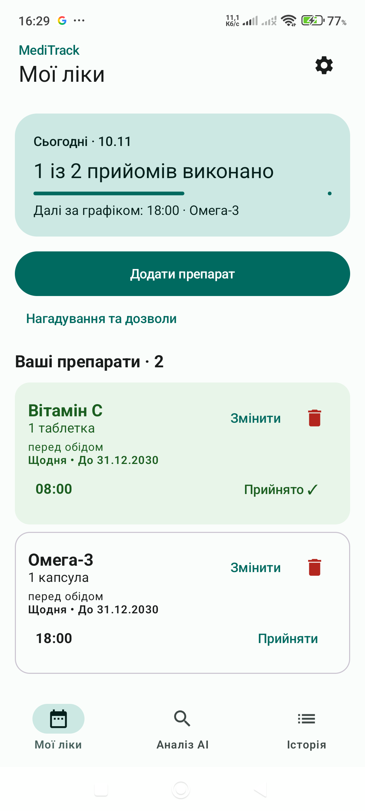
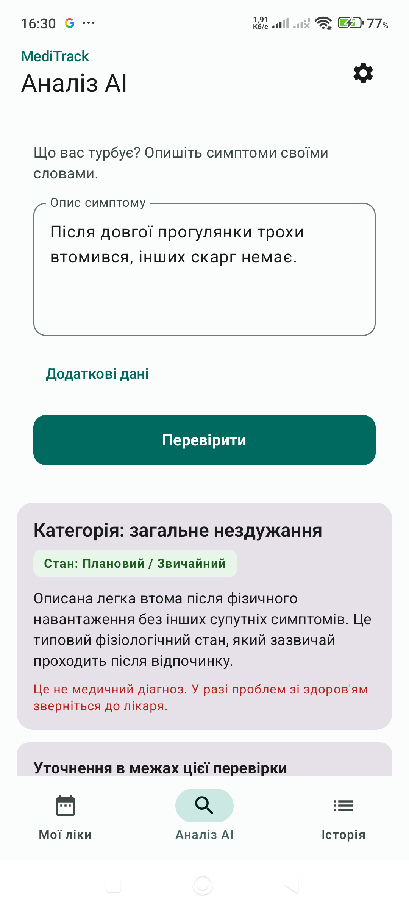
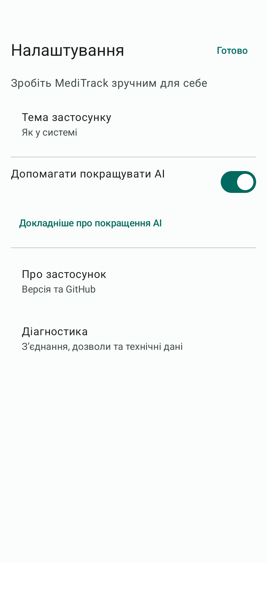
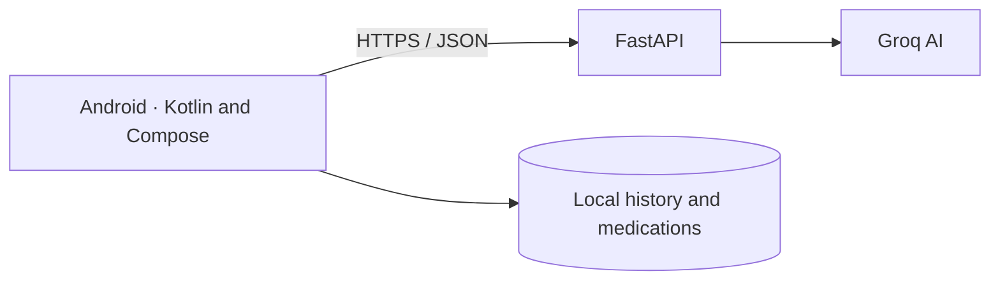

# MediTrack AI

  🌐 <a href="README.md">Українська</a> · <strong>English</strong>

MediTrack AI is an educational Android app for tracking medications and setting reminders. It also groups symptom descriptions into general categories and explains the result.

  

[Releases](https://github.com/Nazarlo3/MediTrack-AI/releases) · [Documentation in Ukrainian](docs/)

## Features

- Medication list with photos, multiple daily doses and intake tracking.
- Scheduled reminders and a daily intake summary.
- AI categorization with optional symptom duration and intensity.
- Follow-up questions when more information is needed and retry after a connection error.
- Local history with up to 20 results that you can view and delete.
- Light and dark themes, connection diagnostics and a data collection toggle.

  
  
  

The screenshots use synthetic data.

## Installation

Download the signed APK from Releases and open it on a device running Android 10 or later. Allow installation from the app you use to open the file if Android prompts you. The official 0.5.1 APK uses the same signing key as 0.5. If your installed build uses a different key, see the [signing compatibility note](docs/guides/development.md#підпис-release).

AI analysis requires an internet connection and sends your description to the server. You can view history offline. The **Help improve AI** setting controls whether new submissions are also stored in Google Sheets for evaluation. It is on by default. [How data is handled](docs/data-collection.md).

> This app is intended for educational demonstrations. AI results are not a medical diagnosis or a substitute for professional medical advice.

## Development

Open the repository root in Android Studio, sync Gradle and run the `app` module. The default debug build connects to the backend on Render. See the [developer guide](docs/guides/development.md) for running FastAPI locally, connecting a phone or emulator and running checks.

| Directory | Contents |
| --- | --- |
| `app/` | Android client, unit tests and instrumented tests |
| `backend/` | FastAPI, AI providers and backend tests |
| `docs/` | Architecture, API and testing |
| `.github/` | CI and contribution templates |

- [Project overview](docs/project-overview.md) · [Architecture](docs/architecture.md) · [API](docs/api-contract.md).
- [Known limitations](docs/known-limitations.md) · [Tests](docs/testing.md).
- [Report a bug](https://github.com/Nazarlo3/MediTrack-AI/issues/new/choose) · [Contribute](.github/CONTRIBUTING.md) · [Report a vulnerability privately](SECURITY.md).
