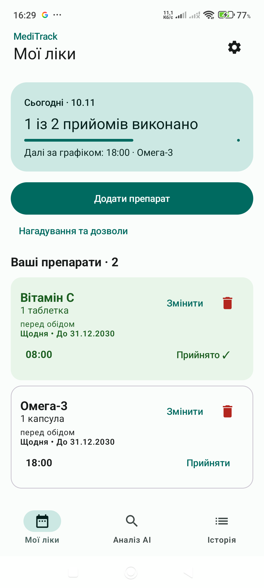
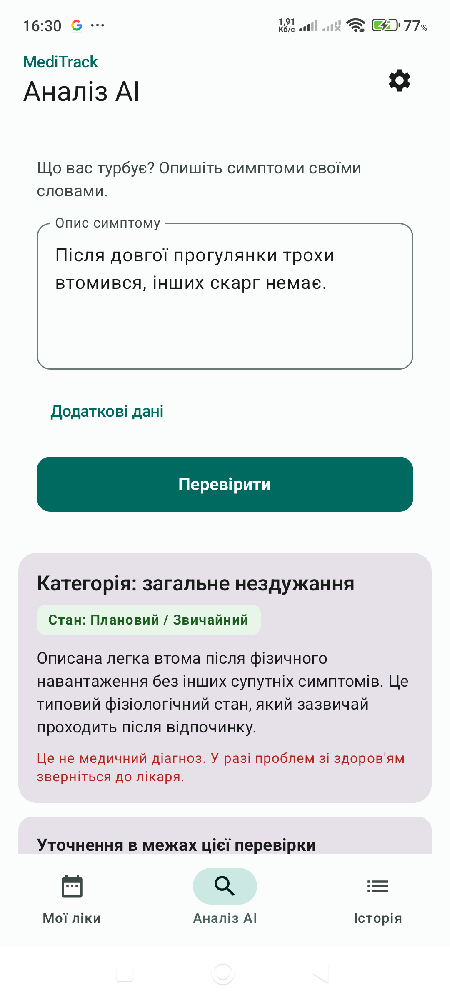
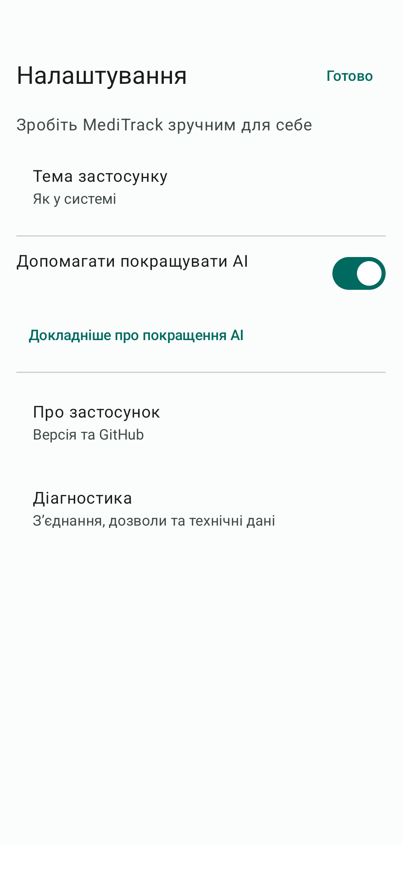
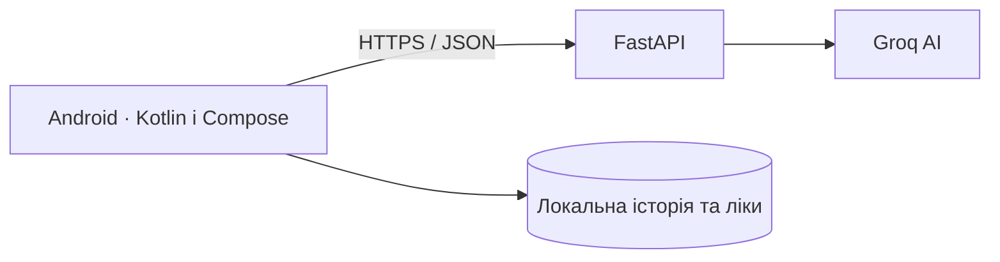

# MediTrack AI

  🌐 <strong>Українська</strong> · <a href="README.en.md">English</a>

MediTrack AI — навчальний Android-застосунок для обліку ліків і нагадувань про прийом. Він також допомагає віднести опис самопочуття до загальної категорії та пояснює результат.

  

[Релізи](https://github.com/Nazarlo3/MediTrack-AI/releases) · [Документація](docs/)

## Можливості

- Список препаратів, фото, кілька прийомів на день і позначки виконання.
- Нагадування за розкладом і підсумок прийомів за день.
- AI-категоризація за описом із необов’язковими полями тривалості й інтенсивності.
- Уточнення за браку інформації та повтор після помилки з’єднання.
- До 20 результатів у локальній історії з переглядом і видаленням.
- Світла й темна теми, діагностика з’єднання та перемикач збору даних.

  
  
  

На знімках використано синтетичні дані.

## Встановлення

Завантажте підписаний APK із Releases і відкрийте його на пристрої з Android 10 або новішим. За потреби дозвольте встановлення з джерела, через яке відкриваєте файл. Офіційний APK 0.5.1 має той самий підпис, що й 0.5. Якщо встановлено збірку з іншим підписом, спочатку ознайомтеся з [приміткою про сумісність](docs/guides/development.md#підпис-release).

AI-аналіз потребує інтернету та надсилає введений опис на сервер. Історію можна переглядати без мережі. Перемикач «Допомагати покращувати AI» керує окремим збереженням нових звернень для оцінювання в Google Sheets. Початково він увімкнений. [Як обробляються дані](docs/data-collection.md).

> Застосунок призначений для навчальної демонстрації. Результат AI не є діагнозом і не замінює консультацію лікаря.

## Розробка

Відкрийте корінь проєкту в Android Studio, виконайте Gradle Sync і запустіть модуль `app`. Типова debug-збірка звертається до сервера на Render. Локальний запуск FastAPI, підключення телефона чи емулятора й команди перевірок описані в [інструкції розробника](docs/guides/development.md).

| Папка | Вміст |
| --- | --- |
| `app/` | Android-клієнт, модульні та інструментальні тести |
| `backend/` | FastAPI, AI-провайдери й тести сервера |
| `docs/` | Архітектура, API та перевірки |
| `.github/` | CI та шаблони для учасників |

- [Огляд проєкту](docs/project-overview.md) · [Архітектура](docs/architecture.md) · [API](docs/api-contract.md).
- [Відомі обмеження](docs/known-limitations.md) · [Перевірки](docs/testing.md).
- [Повідомити про помилку](https://github.com/Nazarlo3/MediTrack-AI/issues/new/choose) · [Запропонувати зміни](.github/CONTRIBUTING.md) · [Приватно повідомити про вразливість](SECURITY.md).
