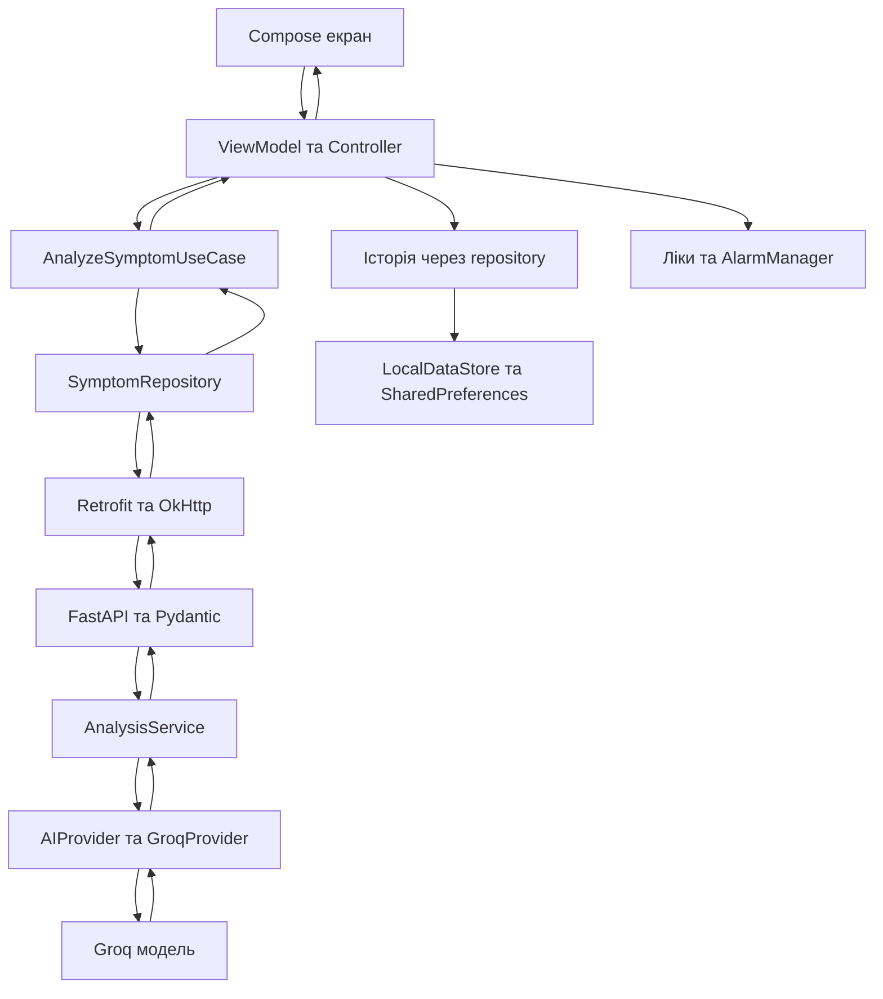

# Архітектура MediTrack AI

0.5.1: `collection_outbox.py` замінює попередню RAM-чергу приватним SQLite outbox за `COLLECTION_OUTBOX_PATH`; commit до queued, ack після Google, відновлення/дедуплікація/відкликання, TTL 24 години. Без постійного сховища — синхронний Google-запис із фактичним saved/unavailable. JSON аналізу сумісний. Виявлено free Render без диска; постійність там не припускається. [Режими й обмеження](data-collection.md).

## Поточні локальні зміни feature_25

`MediTrackApplication` утримує єдиний `SymptomDependencies` для Activity та збереженої ViewModel. `DataCollectionSettings` перевіряє persisted enabled перед запитом і слухає зміни інших екземплярів. Налаштування — окремий `AppSettingsScreen`: тема, збір, GitHub, версія PackageManager та безпечна технічна діагностика. OkHttp зберігає в RAM лише код/час/валідний X-Request-ID останнього AI-запиту, без тіл чи ключів. Release забороняє cleartext; HTTP дозволений тільки debug manifest.

API має bounded admission middleware (частота/одночасність/розмір/час надсилання); це не автентифікація. Google writer використовує чергу RAM на 64 задачі, 3 спроби та дедуплікацію, повертає queued до запису. Відкликання враховує поточні AI-запити/чергу. Один процес/інстанс обов'язковий; черга не переживає рестарт. `MedicationReminderScheduler` підтверджує доставку після notify, повторює невдалу доставку до трьох разів у межах дня; стабільний notification tag замінює попереднє повідомлення при повторі. Гарантії exactly-once або видимості користувачем немає. Джерела й перевірки: [feature_25](impl/feature_25/plan.md), [API](api-contract.md), [збір](data-collection.md).

Реліз 0.5 уже опубліковано ([протокол](impl/release_0_5/changelog.md)); feature_25 ще не розгорнуто. Наступні розділи містять історичні зрізи.

Підготовка розгортання 0.5/code 5 (09.11.2026): debug працює через HTTPS Render, суфікс -debug. Опис нижче зі станом 0.4/ЛР7 є історичним зрізом, доповненим feature_23/24. Фактичний статус публікації — docs/impl/deploy_sheets/changelog.md.

Стан: 04.11.2026, 0.4 та локальна інтеграція ЛР7 (`0.4-lab7` debug). Опублікований release 0.4 не містить змін ЛР7. Карта коду; фактичні перевірки й межі — [feature_22/verification.md](impl/feature_22/verification.md).

## Орієнтири

Кореневого AGENTS.md немає; для цієї директорії застосовується [AGENTS.md](AGENTS.md). Перед змінами читати також [ai-instructions.md](ai-instructions.md). Пріоритети та невизначеності — [ROADMAP.md](ROADMAP.md), рішення — [decisions.md](decisions.md). Назви architecture.md / ARCHITECTURE.md і decisions.md / DECISIONS.md на поточній Windows-файловій системі позначають ті самі файли; не створювати паралельних копій.

MediTrack AI інформаційно категоризує опис самопочуття, зберігає історію та веде локальний список ліків із нагадуваннями. Це не діагностична система. Основний потік: Android → HTTPS/FastAPI → Groq → Android → локальне сховище.

| Директорія | Призначення |
|---|---|
| [app/](../app/) | Єдиний Android-модуль; код нижче відносний до app/src/main/java/com/example/meditrackai/ |
| [backend/](../backend/) | FastAPI, моделі Pydantic, виклик Groq, unittest |
| [gradle/](../gradle/) | Version catalog, Gradle wrapper і JVM daemon |
| [docs/](.) | База знань; impl/feature_* — плани/журнали, releases/ — опис попереднього релізу |
| [experiment/](../experiment/) | Збережені плани експерименту з контекстом; не реалізовані можливості |
| docs/various files/, .artifacts/, signing/ | Локальні ігноровані матеріали, допоміжні артефакти та підпис; не використовувати їхній вміст як публічну документацію |

## Схема поточного потоку



Історія записується лише для придатного результату. Ключ Groq зберігається на backend. Системний промпт/перевірка JSON — у GroqProvider, формат HTTP — у models.py.

## Android та життєвий цикл

- [MainActivity](../app/src/main/java/com/example/meditrackai/MainActivity.kt) — єдина Activity, Compose/Material 3, Scaffold, Snackbar і збереження теми через [ThemeSettings](../app/src/main/java/com/example/meditrackai/data/ThemeSettings.kt). Три теми: SYSTEM/LIGHT/DARK.
- [SymptomCheckScreen](../app/src/main/java/com/example/meditrackai/ui/SymptomCheckScreen.kt) перемикає дві вкладки локальним selectedTab; початкова — «Мої ліки». Navigation Compose/NavHost немає. Історія розташована у вкладці «Аналіз AI», деталі/налаштування — діалоги.
- [MedicationSection](../app/src/main/java/com/example/meditrackai/ui/MedicationSection.kt) містить форму додавання/редагування, список, статуси окремих прийомів і доступ до дозволів. Прийнятий час підсвічується; вся картка — коли прийняті всі часи за сьогодні.
- [HistorySection](../app/src/main/java/com/example/meditrackai/ui/HistorySection.kt) відрізняє завантаження, порожній стан і помилку читання; відкриває історичний результат за ID; видаляє один/усі записи з підтвердженням.
- [SymptomViewModel](../app/src/main/java/com/example/meditrackai/ui/SymptomViewModel.kt) отримує залежності через конструктор і делегує аналіз/історію чистому Kotlin [SymptomAnalysisController](../app/src/main/java/com/example/meditrackai/ui/SymptomAnalysisController.kt) у viewModelScope. [SymptomUiState](../app/src/main/java/com/example/meditrackai/ui/SymptomUiState.kt): Idle/Loading/Success/NoResult/Error, категорії помилок → власні UI-повідомлення. Помилки локального запису — окремий storageError. Ліки ще напряму використовують LocalDataStore, PhotoStorage та планувальник у ViewModel.
- UI збирає Flow через collectAsState; вкладка й форми використовують rememberSaveable/SaveableStateHolder. ON_RESUME перечитує ліки після фонової дії сповіщення та оновлює графік/дозволи. ViewModel переживає зміну конфігурації, але lastRequest і AI-розмова не зберігаються після завершення процесу. DebugMenu відкривається п’ятьма швидкими натисканнями заголовка лише за FLAG_DEBUGGABLE.

## Android: сценарій ЛР5, варіант А

Потік аналізу: Compose → SymptomViewModel → SymptomAnalysisController → [AnalyzeSymptomUseCase](../app/src/main/java/com/example/meditrackai/domain/symptoms/AnalyzeSymptomUseCase.kt) → [SymptomRepository](../app/src/main/java/com/example/meditrackai/domain/symptoms/SymptomRepository.kt) → [DefaultSymptomRepository](../app/src/main/java/com/example/meditrackai/data/symptoms/DefaultSymptomRepository.kt) → MediTrackApi/Retrofit. Історія проходить через той самий repository → SharedPreferencesSymptomHistorySource → LocalDataStore.

- [domain/symptoms/SymptomModels.kt](../app/src/main/java/com/example/meditrackai/domain/symptoms/SymptomModels.kt) не імпортує Android, Compose, Retrofit чи Gson. Use case перевіряє обрізаний опис (3–500), необов’язкові durationDays 1–30/intensity 0–10, порядок/ліміт контексту, готує наступний контекст та історичний запис; час ін’єктується для тестів.
- [SymptomMapper](../app/src/main/java/com/example/meditrackai/data/symptoms/SymptomMapper.kt) відділяє domain від API/storage DTO. Старі DTO лишилися у network/SymptomModels.kt: формат Gson/ключі сховища не змінено. Repository перевіряє повноту відповіді та context_used/details_used, класифікує HTTP/IO/storage помилки.
- [SymptomDependencies](../app/src/main/java/com/example/meditrackai/di/SymptomDependencies.kt) — ручна DI/фабрика ViewModel; один LocalDataStore спільний для історії та ліків. FakeSymptomRepository існує лише в src/test; користувацький екран завжди використовує справжній repository.
- Успіх AI показується до дискового збереження. Помилка запису історії не перетворює успішний аналіз на мережеву помилку. Controller має незалежні стани завантаження історії, недоступності й вибраного запису.
- «Скасувати аналіз» діє лише у Loading: скасовує Job, початковий аналіз повертається в Idle, уточнення — до попереднього Success або NoResult. Запізнілі результат/помилка не змінюють UI та не додають історію; CancellationException передається далі. Чернетки залишаються в rememberSaveable; чернетка уточнення очищується лише для нового успішного analysisId.
- Скасування на телефоні не гарантує припинення обчислення вже прийнятого сервером запиту. Після завершення Loading почате збереження кнопкою не скасовується. Аналіз, контекст і Job не відновлюються після завершення процесу.

## Дані

[LocalDataStore](../app/src/main/java/com/example/meditrackai/data/LocalDataStore.kt) — SharedPreferences + Gson JSON, операції на Dispatchers.IO під спільним Mutex. Стан даних публікується після успішного commit; readError блокує записи, щоб не перезаписати пошкоджені дані.

| Дані | Поточне збереження та правила |
|---|---|
| Історія | meditrack_prefs / symptom_history_v2; id, createdAt, timestamp, description, response, status=готово. [HistoryJsonCodec](../app/src/main/java/com/example/meditrackai/data/HistoryJsonCodec.kt): до 20 записів, новіші зверху; старі без повної дати мають createdAt=null. Читає старі symptom_history / meditrack_history_prefs:symptom_history_v1. Видалення прибирає старі копії історії. |
| Ліки | meditrack_prefs / medications_list_v3. [MedicationJsonCodec](../app/src/main/java/com/example/meditrackai/data/MedicationJsonCodec.kt): міграція v2/v1, стабільний ID, times (до 12 унікальних HH:mm), takenDoseDates (час → ISO-дата), scheduleVersion, фото/дозування/дні/кінець курсу. Старий статус переноситься лише з наявною датою; некоректний старий час не перетворюється на вигаданий alarm. |
| Фото | [PhotoStorage](../app/src/main/java/com/example/meditrackai/ui/PhotoStorage.kt) копіює обраний URI у filesDir/med_photos; у моделі — шлях. Видалення обмежене цією директорією. |
| Тема / alarm | meditrack_settings; окремо medication_dose_reminders зі службовими часами/версіями/токенами. |

Зміни ліків перечитують актуальний v3 під Mutex; оновлення історії працює з кешем конкретного LocalDataStore. Це не загальна транзакційна БД. Старі ключі ліків залишаються знімком: відкат до старого APK не бачить нових змін v3.

## API та AI

Джерела контракту: [ApiClient.kt](../app/src/main/java/com/example/meditrackai/network/ApiClient.kt), [SymptomModels.kt](../app/src/main/java/com/example/meditrackai/network/SymptomModels.kt), [main.py](../backend/main.py), [models.py](../backend/models.py).

- Retrofit/Gson + OkHttp; адреса з BuildConfig.BACKEND_URL; release завжди Render HTTPS, debug допускає Gradle property meditrack.backendUrl, connect/read/write timeout — по 60 с. Зміна адреси у налаштуваннях не реалізована.
- GET /health → status=ok. Перевіряє доступність обробника, а не Groq/ключа.
- POST /analyze-symptom: description довжиною 3–500; context необов’язковий, до 6 попередніх повідомлень (повні пари user/assistant), непорожній content до 1500 символів. Додаткові duration_days 1–30 та intensity 0–10 — strict integer або null. Інші ролі й порядок відхиляються.
- Відповідь: category, explanation, urgency, disclaimer, follow_up_question (рядок до 300 або null), context_used, details_used, has_usable_result. Snake_case поля мапляться через SerializedName. Явне false означає успішну обробку без придатної категоризації: NoResult показує пояснення/питання, дозволяє уточнення, не створює запис історії. Відсутнє поле у старій відповіді зберігає попередню поведінку; категорія «інше» сама по собі не є NoResult.
- Уточнень до трьох у поточній ViewModel-сесії. context_used=true потрібний для прийняття уточнення від сервера; це підтвердження передачі контексту, не якості його використання моделлю. Retry відтворює той самий запит. Кожен придатний успіх додає окремий запис із накопиченими користувацькими описами.
- Pydantic перевіряє довжину до strip(); обробник додатково відхиляє лише повністю пробільний опис (400). Валідація Pydantic — 422, domain errors провайдера — 503, неочікувана помилка — загальний JSON 500. Android показує власні повідомлення; HTTP/мережеві помилки й неповні результати не стають записами «готово».

[ai_service.py](../backend/ai_service.py): requests.post до Groq Chat Completions, модель qwen/qwen3.8-27b, json_object, temperature=0.1, max_tokens=400, timeout=15 с. Порядок messages: системні правила → context → новий опис із наданими duration_days/intensity. Є 16 категорій і три urgency: звичайне/увага/терміново.

_validate_ai_result нормалізує регістр, невідому категорію замінює на «інше», невідому urgency відхиляє; перевіряє поля та необов’язкове питання. Android повторно перевіряє результат через [SymptomResponseValidator](../app/src/main/java/com/example/meditrackai/validation/SymptomResponseValidator.kt). При недоступності Groq немає резервної моделі чи офлайн-аналізу: контрольована помилка й ручний повтор. GROQ_API_KEY читається єдиним config.py із середовища / backend/.env; ключ не передається в APK. Backend не має власної БД, облікових записів, автентифікації чи лімітування запитів у перевіреному коді.

## Backend після ЛР5

Варіант Б, сценарій аналізу та уточнень. HTTP route → AnalysisService → AIProvider Protocol → GroqProvider / FakeProvider. Android-архітектура вище не змінювалася.

| Компонент | Відповідальність |
|---|---|
| [domain.py](../backend/domain.py) | AnalysisInput, ConversationMessage, AnalysisResult, AIProvider, domain errors; без FastAPI/Pydantic/requests/.env |
| [analysis_service.py](../backend/analysis_service.py) | Перевірка опису й контексту, нормалізація, виклик ін’єктованого провайдера, context_used |
| [models.py](../backend/models.py) | Pydantic request/response, явні to_domain/from_domain |
| [ai_service.py](../backend/ai_service.py) | GroqProvider: HTTP до Groq, системний промпт,  перевірка provider JSON → AnalysisResult |
| [fake_provider.py](../backend/fake_provider.py) | Синтетичний успіх/контрольована помилка за тим самим інтерфейсом, без мережі |
| [config.py](../backend/config.py) | Єдиний читач середовища/backend/.env; кешовані Settings, api_key приховано з repr |
| [dependencies.py](../backend/dependencies.py) | Composition root через Depends; get_provider можна підмінити dependency_overrides |
| [main.py](../backend/main.py) | Маршрути й централізоване перетворення domain errors у 400/503, неочікуваних у загальну 500 |
| [request_context.py](../backend/request_context.py) | HTTP middleware, серверний request_id у X-Request-ID та логах, без request body/секретів |

AI_PROVIDER вибирає groq або fake; GROQ_MODEL та AI_TIMEOUT_SECONDS змінюють стандартні модель/15 с; GROQ_API_KEY потрібний лише реальному адаптеру. FAKE_PROVIDER_ERROR=true створює контрольовану demo-помилку лише у fake-режимі. Це явний вибір, не резервний медичний висновок. Налаштування читаються ліниво й кешуються на процес; після зміни потрібний перезапуск.

Після контрольної перевірки рефакторингу додано request_id: генерується для кожного HTTP-запиту, не копіюється з клієнтського заголовка; повертається також для 400/422/503/500. Старі JSON-поля не змінені. Логи містять ID, метод, HTTP-статус і тип помилки, без опису та сирого exception.

## Ліки та нагадування

[MedicationSchedule](../app/src/main/java/com/example/meditrackai/reminders/MedicationSchedule.kt) обчислює наступний прийом у локальному часовому поясі за часом, днями та включною кінцевою датою. Позначення одного часу не скасовує інші; редагування зберігає ID й дати незмінених часів, оновлюючи scheduleVersion.

[MedicationReminderScheduler](../app/src/main/java/com/example/meditrackai/reminders/MedicationReminderScheduler.kt) тримає окремі PendingIntent/notification tag за ID+часом. За дозволу використовує setExactAndAllowWhileIdle, інакше setAndAllowWhileIdle. POST_NOTIFICATIONS перевіряється окремо від точних alarm та стану каналу.

Receiver-и у [reminders/](../app/src/main/java/com/example/meditrackai/reminders/) не експортовані, виконують goAsync з лімітом 8 с, перечитують диск незалежно від UI. RestoreReceiver обробляє reboot, оновлення пакета, зміну годинника/поясу й надання точного дозволу. «Прийняв»/«Через 10 хв» перевіряють дату, час, версію й токен; відкладення зберігається лише в межах тієї самої дати. [ReminderAlarmRegistration](../app/src/main/java/com/example/meditrackai/reminders/ReminderAlarmRegistration.kt) фіксує час після реєстрації й не переносить на завтра alarm, що очікує доставки.

Force stop, системні обмеження та відсутні дозволи можуть завадити доставці. Пропущені прийоми не надолужуються. Маркер доставки записується перед notify(): гарантії «рівно один раз» немає.

## Конфігурація та запуск

Підтверджено конфігурацією, а не новим запуском:
- [app/build.gradle.kts](../app/build.gradle.kts): compile/target SDK 37, minSdk 29, versionName=0.4 / versionCode=4, debug suffix=-lab7, Java target 11; release — R8/resource shrinking, власний підпис із локального keystore.properties, без нього — без підпису.
- [libs.versions.toml](../gradle/libs.versions.toml) / [wrapper](../gradle/wrapper/gradle-wrapper.properties): AGP 9.4.1, Gradle 9.6.0, Compose plugin 2.2.10, Compose BOM 2026.02.01, lifecycle-runtime-ktx 2.11.0, activity-compose 1.8.0; ViewModel Compose 2.8.4, Retrofit 2.11.0, OkHttp 4.12.0, coroutines-android 1.8.1 задані в app/build.gradle.kts. Daemon [потребує JVM 25](../gradle/gradle-daemon-jvm.properties); Java target 11 не означає JDK 11 для Gradle.
- [requirements.txt](../backend/requirements.txt): fastapi, uvicorn[standard], pydantic, requests, python-dotenv без фіксованих версій. Код використовує Pydantic v2 та синтаксис Python 3.10+; конкретна версія Python не закріплена.

Android: відкрити корінь в Android Studio, встановити SDK 37/JVM для daemon, Gradle Sync → Run app. Команди з кореня:
```powershell
.\gradlew.bat :app:assembleDebug
.\gradlew.bat :app:testDebugUnitTest
.\gradlew.bat :app:lintDebug
.\gradlew.bat :app:assembleDebugAndroidTest
```
Backend у власному Python-середовищі, із GROQ_API_KEY у середовищі або backend/.env:
```powershell
python -m pip install -r backend/requirements.txt
Set-Location backend
python -m uvicorn main:app --host 0.0.0.0 --port 8000
```
Локальний сервер сам не перемикає Android: debug збирається з -Pmeditrack.backendUrl=http://127.0.0.1:18765/ і adb reverse або з адресою ПК у спільній мережі. Повні кроки — README. З кореня тести backend:
```powershell
python -m unittest discover -s backend/tests -v
```
Для HTTP-тестів спочатку встановити backend/requirements-dev.txt (HTTPX та httpx2 для поточного Starlette). Тести використовують unittest і mock; pytest не оголошений у залежностях, попри типовий приклад у docs/AGENTS.md.

## Перевірки та межі

- [app/src/test/](../app/src/test/): FormValidators, SymptomResponseValidator, HistoryJsonCodec, MedicationSchedule, реєстрація alarm, MultiDoseTest та нові AnalyzeSymptomUseCaseTest/SymptomRepositoryTest/SymptomAnalysisControllerTest з FakeSymptomRepository; також шаблонний ExampleUnitTest.
- [app/src/androidTest/](../app/src/androidTest/): історія/Compose/SharedPreferences, міграція ліків, тема, дії нагадувань і форма. Тестові сховища ізольовані; LiveHistoryReportTest читає реальну історію лише з явним reportPhase. Snooze-тест має часовий assume, тому можливі пропуски.
- [backend/tests/test_ai_service.py](../backend/tests/test_ai_service.py): формат, категорії, таймаут, контекст, Pydantic; частина regression-тестів викликає обробник напряму; test_api.py додатково перевіряє HTTP-шлях через TestClient з DI override.
- .github/workflows, Dockerfile, Render deployment manifest і lock-файл Python у дослідженій структурі відсутні. Автоматизований CI/CD не описаний кодом; налаштування Render поза репозиторієм не перевірено.
- Власного шифрування сховища немає. [Manifest](../app/src/main/AndroidManifest.xml) дозволяє backup і cleartext, а [backup rules](../app/src/main/res/xml/data_extraction_rules.xml) не задають виключень. Не вважати приватне сховище гарантією відсутності резервного копіювання. Не читати/копіювати секрети чи реальні медичні записи для наступних задач.

### Перевірка Android на телефоні після ЛР5

[Lab5PhoneScenarioTest](../app/src/androidTest/java/com/example/meditrackai/Lab5PhoneScenarioTest.kt) — opt-in сценарії зі справжніми UI/ViewModel/use case/repository/Retrofit, ізольованими SharedPreferences і явно ін’єктованим локальним API. На фізичному Android 15 перевірено аналіз/уточнення/історію через FastAPI → Groq, контрольовані IOException/retry та очікування/cancel. Це історична перевірка ЛР5. У ЛР7 звичайна MainActivity бере адресу із BuildConfig; production URL залишено Render, локальний debug задається під час збірки. Результати й межі — у testing.md, [feature_14](impl/feature_14/changelog.md).


## Добровільний збір звернень — feature_23

05.11.2026: DataCollectionSettings (приватні prefs, StateFlow) спільний для MainActivity/екрана та DefaultSymptomRepository через CollectionPreferences. До явного вибору metadata/token не передаються. Для погодженого збору використовується CollectionApi; основний legacy MediTrackApi сумісний. Потік після AI: HTTP route → CollectionService → CollectionRepository/SQLite. БД відсутня, доки оператор не задасть COLLECTION_DB_PATH; collection admin secret окремий від Groq. SQL/збір не є залежністю доменного AnalysisService. Фонове очищення у FastAPI lifespan, додаткове очищення при операціях. Власні приватні ключі виключено з backup/transfer.

Це окрема наступна зміна після перевіреного APK ЛР7; його історичні хеші не описують нову збірку. Хмарна активація/постійне сховище ще не виконані. [План](impl/feature_23/plan.md), [експлуатація і межі](data-collection.md).

## Google Sheets — 09.11.2026

Feature_24: фабрика get_collection_repository обирає SheetsCollectionRepository + SheetsTransport за GOOGLE_SHEETS_ID, інакше SQLite/disabled. Згода Google версії 2; очищення використовує ту саму фабрику. Кеш repository/токена, блокування процесу, атомарні batchUpdate для запису/статистики та видалення/відкликання. Тільки один процес/інстанс; це не транзакційне сховище для кількох серверів. Подробиці й конфігурація — data-collection.md.
